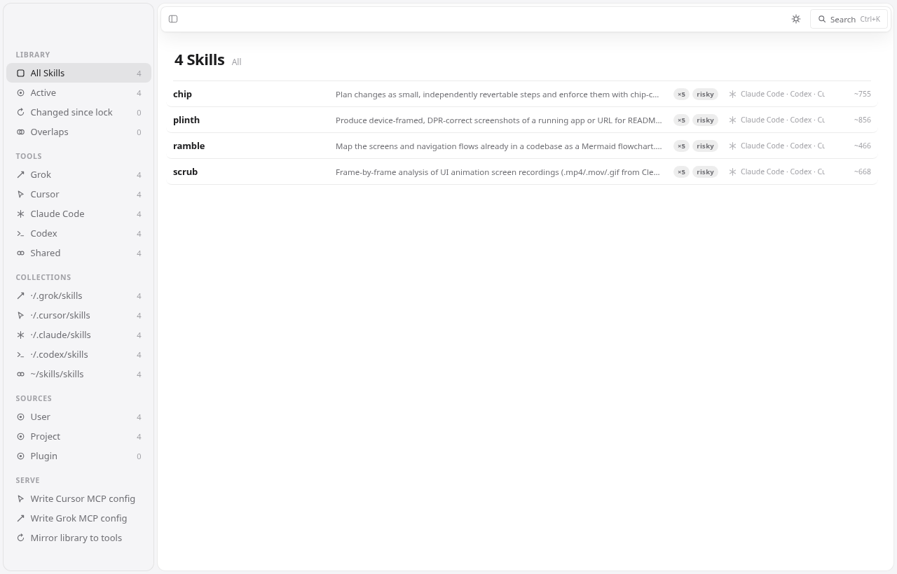
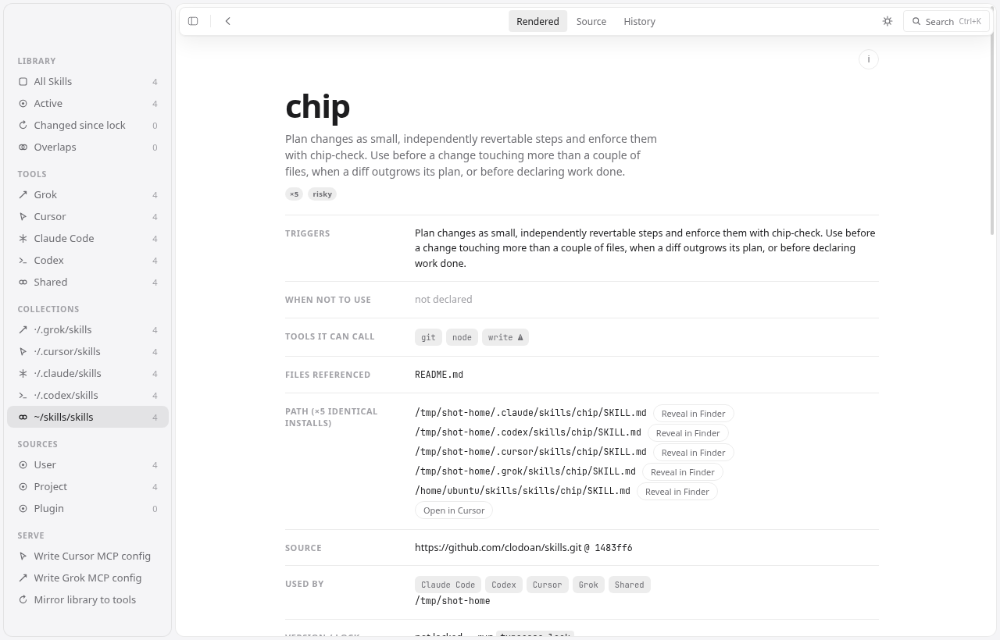

# Typecase

The case your agent skills live in. Typecase finds every skill installed
for Grok, Cursor, Claude Code, and Codex, parses each `SKILL.md` into a
structured record, and gives you four layers on top:

1. **A parser library** (`scripts/lib/`) — discovery, parsing, duplicate
   and overlap detection. Importable; everything else is built on it.
2. **A reader** — `ls`, `where`, `show` in the terminal, plus a Mac-first
   Electron app (`open`).
3. **A lockfile and changelog** — `lock`, `diff`, `pin`, and a running
   `TYPECASE.md` with one plain-language paragraph per skill change.
4. **A serving layer** — one skills repo as the single source of truth:
   an [MCP server](#one-library-served-everywhere-mcp) (local and on your
   own Cloudflare Worker) that publishes every skill as an MCP prompt,
   plus a generated read-only [mirror](#the-local-mirror) for tools that
   only scan skill folders. No copies committed to any repo.


*All screenshots show public open-source skill packs only (Anthropic's
[skills](https://github.com/anthropics/skills), Figma's
[mcp-server-guide](https://github.com/figma/mcp-server-guide),
[donald-ada/workinggenius](https://github.com/donald-ada/workinggenius),
and [clodoan/skills](https://github.com/clodoan/skills)) — nothing private
or internal.*

## Install the Mac app

```bash
curl -fsSL https://raw.githubusercontent.com/clodoan/typecase/main/install.sh | sh
```

This downloads the latest release for your Mac (Apple silicon or Intel),
installs `Typecase.app` into `/Applications`, and opens it. Run the same
command again to update. Read [`install.sh`](install.sh) before you pipe
it to `sh`. The app isn't notarized, so the script removes the macOS
quarantine flag, and Gatekeeper does not check the app on first open.

To install by hand, download `Typecase-mac-arm64.zip` (Apple silicon) or
`Typecase-mac-x64.zip` (Intel) from
[Releases](https://github.com/clodoan/typecase/releases/latest), unzip it,
and drag `Typecase.app` into Applications. The app isn't notarized, so
macOS blocks the first open: go to **System Settings → Privacy & Security**
and click **Open Anyway**, or run
`xattr -dr com.apple.quarantine /Applications/Typecase.app`.

To check a download, compare `shasum -a 256 Typecase-mac-arm64.zip` with
the SHA-256 digest that the release page shows next to the asset. To
report a vulnerability, see [SECURITY.md](SECURITY.md).

## Quick start

```bash
node scripts/typecase.mjs ls                     # everything installed
node scripts/typecase.mjs where "crop a video"   # which skill handles this?
node scripts/typecase.mjs show chip              # read one skill
node scripts/typecase.mjs lock                   # pin current state
node scripts/typecase.mjs diff                   # what changed since lock (exit 1 if anything)
node scripts/typecase.mjs pin chip               # restore a skill from its snapshot
node scripts/typecase.mjs open                   # desktop reader
node scripts/typecase.mjs mcp --library ~/skills # serve the library over MCP (stdio)
node scripts/typecase.mjs mirror --library ~/skills --watch  # generated local mirror
node scripts/typecase.mjs connect cursor --library ~/skills  # write ~/.cursor/mcp.json
```

The CLI has zero dependencies (Node ≥ 18). The desktop app is a separate
optional package under [`app/`](app/) — Electron is **not** a dependency
of the CLI.


## Where it looks

Every path is sourced; the same table lives as a comment in
[`scripts/lib/paths.mjs`](scripts/lib/paths.mjs).

| Tool | Project | User | Plugin / other | Source |
| --- | --- | --- | --- | --- |
| Grok | `.grok/skills` (walked up to the repo root) | `$GROK_HOME/skills`, default `~/.grok/skills` | `./.grok/plugins` and `~/.grok/plugins` (each plugin's `skills/`), marketplace installs under `~/.grok/plugins/marketplaces/` | [docs.x.ai](https://docs.x.ai/build/features/skills-plugins-marketplaces) |
| Cursor | `.cursor/skills`, `.agents/skills` (nested dirs too) | `~/.cursor/skills`, `~/.agents/skills` | `~/.cursor/plugins/cache/<marketplace>/<id>/<rev>/skills/` (observed layout, not documented — may change) | [cursor.com/docs/skills](https://cursor.com/docs/skills) |
| Claude Code | `.claude/skills` (this dir and parents) | `~/.claude/skills` | plugins ship `skills/` folders under `~/.claude/plugins/` | [code.claude.com](https://code.claude.com/docs/en/skills) |
| Codex | `.agents/skills` (cwd up to repo root) | `~/.codex/skills` (`$CODEX_HOME`, scanned recursively per docs), `~/.agents/skills` | admin `/etc/codex/skills` | [developers.openai.com](https://developers.openai.com/codex/skills) |

`.agents/skills` dirs are read by Grok, Cursor, and Codex alike, so
Typecase reports them once under the pseudo-tool `shared` instead of
triple-counting one install.

Two dedupe rules keep the list honest. First, the Cursor plugin cache
keeps old revisions on disk; Typecase scans only the newest revision of
each plugin (by directory mtime), so a plugin update doesn't show up as
two skills. Second, byte-identical installs of the same skill (same name,
same content hash — e.g. one pack installed for both Claude Code and
Cursor) collapse into a single entry marked `×N` in `ls` and in the app's
row list; the detail view still lists every install path. Copies with the
same name but *different* content stay separate — that's a real conflict,
and it stays flagged.

Extra locations: drop a `typecase.json` in the working directory or
`~/.config/typecase/`:

```json
{ "paths": [{ "dir": "/opt/team-skills", "tool": "shared", "scope": "user" }] }
```

## What the parser extracts

`parseSkill` returns one record per skill: frontmatter (`name`,
`description`, the rest verbatim), tool, scope (user / project / plugin /
admin), paths, every section with a token estimate, trigger text,
"when not to use" text, referenced files that resolve inside the skill
folder, commands mentioned in code spans, risky tool mentions (network,
write, exec, sudo), total token size, and a content hash over the whole
skill folder. Malformed skills become parse-error records instead of
crashing the run.

On top of the records, discovery flags **duplicates** (same name
installed for more than one tool — marked identical when the content
hashes match) and **overlaps** (pairs whose trigger vocabulary passes a
Jaccard similarity threshold of 0.35 — skills that will race for the
same requests).

```js
import { discover, where } from "./scripts/lib/discover.mjs";
const data = discover();            // { roots, skills, duplicates, overlaps }
const hits = where(data, "resize a video");
```

`ls --json` and `diff --json` emit the same structures for scripting.

## Lock, diff, pin

`lock` writes `skills.lock`: per skill, the content hash, token size, and
the best source identity it can find — the git remote + commit if the
skill folder lives in a repo, a plugin/package version from a nearby
manifest, or `local`. It also snapshots each skill folder by hash under
`~/.cache/typecase/snapshots/` so `pin <skill>` can restore the locked
version later (the current version is backed up first).

`diff` re-discovers everything and compares against the lock **section by
section** — added/removed/rewritten sections, trigger changes, "when not
to use" changes, command and risky-tool deltas — then compresses each
skill's changes into one plain-language paragraph about what the agent
will now do differently. Real output from bumping Anthropic's
[skills](https://github.com/anthropics/skills) pack from `5304866` to
`dbd4588`:


> **frontend-design** changed: a new "Ground your designs in the subject
> matter" rule was added; a new "Process: plan, review against the brief,
> build, critique" rule was added; 2 rules were dropped; 4 sections were
> rewritten.

Paragraphs are deterministic by default. Set `TYPECASE_LLM_CMD` to any
shell command to route the change JSON (stdin) through an LLM instead;
on any failure it falls back to the deterministic text.
`diff --write-changelog` appends dated entries to `TYPECASE.md`, and
`lock` does the same automatically when it replaces an older lock.

## One library, served everywhere (MCP)

Keep every skill in **one git repo you own** (e.g. `you/skills`) and let
each agent read it from there — no copies committed to any project repo.
Typecase ships an MCP server with three tools (`list_skills`, `get_skill`,
`get_skill_file`), every skill as an MCP **resource**, and — the part that
puts skills in slash menus — every skill as an MCP **prompt**.

Run it locally against a checkout (stdio is what editors spawn; `--http`
serves the same thing on a port; `--repo` serves straight from GitHub):

```bash
node scripts/typecase.mjs mcp --library ~/skills
npx -y github:clodoan/typecase mcp --library ~/skills        # no checkout needed
node scripts/typecase.mjs mcp --library ~/skills --http 8787 # Streamable HTTP
node scripts/typecase.mjs mcp --repo you/skills              # GitHub-backed
```

`typecase connect cursor` and `typecase connect grok` write the server
into `~/.cursor/mcp.json` and `~/.grok/config.toml` (`[mcp_servers.typecase]`)
without touching anything else in those files. The desktop app has the
same two actions as buttons under **Serve**, plus **Mirror library**.

Where MCP prompts actually show up today:

| Agent | MCP prompts in the slash menu | What covers it instead |
| --- | --- | --- |
| Cursor IDE | yes — type `/` ([docs](https://cursor.com/docs/mcp): Prompts supported) | — |
| Claude Code CLI | yes — `/mcp__typecase__<skill>` | — |
| Grok (TUI/Build) | no — MCP tools only; the slash menu lists built-ins and skills | the [mirror](#the-local-mirror) |
| Codex CLI | no — tools only ([openai/codex#5059](https://github.com/openai/codex/issues/5059) open) | the [mirror](#the-local-mirror) |
| Cursor cloud agents | tools only; configured in [cursor.com/agents](https://cursor.com/agents), not `.cursor/mcp.json` | the Worker below |

### Your own Cloudflare Worker (for cloud agents)

Cloud agents can't spawn your local server, so deploy the same core to a
Worker **you** own — it serves your skills repo via the GitHub API:

```bash
cd worker && npm install
npx wrangler deploy --var SKILLS_REPO:you/skills
# private repo or rate limits:   npx wrangler secret put GITHUB_TOKEN
# require a bearer token:        npx wrangler secret put AUTH_TOKEN
```

Then add `https://typecase-mcp.<you>.workers.dev/mcp` as a Custom MCP
(type HTTP) in the Cloud Agents dashboard — cloud agents read MCP config
from [cursor.com/agents](https://cursor.com/agents) or the team
dashboard, not from the repo. `wrangler dev` runs the identical Worker
locally. The Worker and the local server share `scripts/lib/mcp-core.mjs`;
there is no second implementation.

### The local mirror

Grok and Codex (and native `/skill` autocomplete in general) want real
folders. The mirror writes a **generated, read-only** copy of the library
into the user-level folders each tool scans — `~/.grok/skills`,
`~/.cursor/skills`, `~/.claude/skills`, `~/.codex/skills` — and nowhere
near a repo, so there is nothing to commit:

```bash
node scripts/typecase.mjs mirror --library ~/skills          # once
node scripts/typecase.mjs mirror --library ~/skills --watch  # auto-refresh
node scripts/typecase.mjs mirror --remove                    # take it all back
```

Every mirrored folder carries a `.typecase-mirror` marker (source path,
version, timestamp); files are written `0444`. The mirror only ever
overwrites or prunes folders that have the marker — a hand-written skill
with the same name is left alone and reported. Edit skills in the source
repo (or through Typecase); the mirror is output, not a place to work.

In the app, each skill's detail view shows **Source** (git remote +
commit, plugin version, or plain folder), **Used by** (which agents load
it, and which repos for project-scope installs), and the install paths.
The sidebar's **Serve** section holds the two config writers and the
mirror (the first use asks which folder your library is, then remembers
it in `~/.config/typecase/typecase.json`).




## The desktop app

`typecase open` launches a Mac-first Electron reader (floating sidebar,
system font, light and dark themes that follow the system,
full keyboard navigation, ⌘K search). The palette is neutral macOS gray —
`#f5f5f7` canvas with white panels in light, near-black in dark — with a
single verdigris accent; rubric red is reserved for risky flags. Styling
is [StyleX](https://stylexjs.com) compiled at build time; there are no
animations or transitions anywhere — every interaction renders
immediately. It imports the same parser library as the CLI —
no duplicated parsing logic — and live-reloads when any skill folder
changes on disk.


- **Sidebar** — Library (All, Active, Changed since lock, Overlaps),
  Tools, Collections (one per skill root), Sources (user / project /
  plugin scope).
- **Row list** — one compact hairline row per skill: name, one-line
  description, copies (×N) / risky / overlap / changed chips, tool ·
  scope, token size. Identical installs across tools collapse into one
  row marked `×N`. Arrow-key navigation. The floating toolbar holds the
  sidebar toggle, a back chevron and the
  Rendered / Source / History tabs in the detail view, the theme toggle
  (system / light / dark), and the ⌘K search pill. ⌘K finds skills and
  also switches theme: type "light", "dark", "system", or "theme".
- **Detail view** — hairline rows for triggers, when (not) to use, tools
  it can call with risky flags, files referenced, every install path
  (Reveal in Finder / Open in Cursor), overlaps, and lock state, followed
  by the skill's full body rendered as Markdown (markdown-it: headings,
  lists, code blocks, tables; raw HTML stays escaped, links open in your
  browser or editor and never navigate the app); an info
  button shows raw frontmatter. The toolbar tabs switch
  **Rendered / Source / History** (keys 1–3) — History shows the locked version,
  the since-lock paragraph with a section-level diff, and this skill's
  `TYPECASE.md` entries.
- **Keyboard** — ⌘K search, ⌘\\ sidebar, ⌘[ / ⌘] back and forward
  through the skills and filters you visited (scroll position included),
  arrows + ↩ on the list, Esc and 1–3 on a skill. Every shortcut is
  declared in [`app/renderer/src/shortcuts.mjs`](app/renderer/src/shortcuts.mjs);
  add one there and give `app.js` an action with the same id.


Run it in development:

```bash
cd app
npm ci
npm start                 # or: node ../scripts/typecase.mjs open
```

`npm start` builds the renderer first (Rollup + the StyleX plugin →
`renderer/dist/`); `npm test` and `npm run dist` do the same. To build it
alone, `npm run build`.

Package an unsigned local Mac `.app` (no notarization; for your own
machine):

```bash
cd app
npm run dist              # electron-builder --mac --dir → dist/mac*/Typecase.app
```

Build the downloadable release zips (ad-hoc signed, Apple silicon and
Intel) that `install.sh` fetches:

```bash
cd app
npm run release           # → dist/release/Typecase-mac-{arm64,x64}.zip
gh release create v0.x.y dist/release/*.zip
```

The packaged app uses the green icon (`build/icon.icns`); `npm start` runs
show the amber DEV icon in the Dock so the two never get mixed up. Both
are drawn in `build/make-icons.mjs`; run `npm run icons` after editing it.

If the app dependencies aren't installed, `typecase open` falls back to
writing a small self-contained HTML reader to a temp file and opening it
in your browser — kept deliberately tiny (search, filters, detail,
History) so `open` still does something useful on a headless box or
fresh machine.

## Testing

```bash
node --test scripts/typecase.test.mjs scripts/mcp.test.mjs  # parser, CLI, MCP server, mirror, connect
cd app && npm ci && npm test            # Electron smoke (7 tests; builds the renderer first)
```

CI runs both; the Electron suite runs under `xvfb-run` on Linux runners.

## Tested on (real packs)

| Pack | Commit | Result |
| --- | --- | --- |
| [anthropics/skills](https://github.com/anthropics/skills) | `5304866` → `dbd4588` | 20 skills parsed; lock → version bump → `diff` produced the paragraphs above; `pin` restored the locked `frontend-design` |
| [figma/mcp-server-guide](https://github.com/figma/mcp-server-guide) | `b0bfad2` | 14 skills; `figma-generative-plugins` ↔ `figma-shaders` flagged as overlapping (0.52 shared trigger vocabulary) |
| [donald-ada/workinggenius](https://github.com/donald-ada/workinggenius) | `3823c44` | 24 skills incl. an `errata` skill (which is why this tool isn't called Errata); 3 overlap pairs flagged |
| [clodoan/skills](https://github.com/clodoan/skills) | — | chip, scrub, plinth, ramble; `where "animation timing easing jank"` → scrub (score 0.54) |

Side by side that's 61 installs across four tools, shown as 60 entries:
the one planted cross-tool duplicate (`figma-design-to-code` installed
for both Claude Code and Cursor) is detected as identical copies and
folds into a single `×2` entry. `poteto/pstack` was
requested as a test pack but isn't publicly available, so the public
packs above stand in for it.

## Notes

- Name check: "errata" collides with an existing agent skill
  (donald-ada/workinggenius) and an npm CLI; "typecase" — a printer's
  type drawer — had no agent-skill, CLI, or Figma-plugin collisions at
  the time of writing.
- `skills.lock` and `TYPECASE.md` are per-directory, so a repo can pin
  its project skills independently of your user-level installs.
